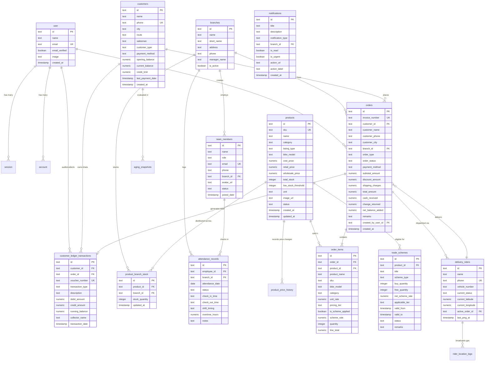

# Sarfraz Autos - Shop Counter System
## Comprehensive Database Schema & Backend Architecture Specification

> **Document Version:** 1.0.0  
> **Target Database Engine:** Neon Serverless PostgreSQL  
> **ORM & Migration Engine:** Drizzle ORM (TypeScript)  
> **Standard Table Pagination:** **Strictly 12 Items per Page** (`LIMIT 12 OFFSET (page - 1) * 12`)  
> **File Location:** `plan/database-schema-architecture.md`

---

## 1. Executive Architecture Overview

This document specifies the complete relational database architecture, field schemas, foreign key relationships, indexes, and backend query/filtering specifications for the **Sarfraz Autos - Shop Counter & Inventory Management Application**.

### 1.1 Architectural Principles
1. **Relational Integrity & Foreign Keys**: Every record referencing another entity (e.g., branch, customer, product, user) enforces explicit foreign key constraints with defined cascade or restrict rules.
2. **Multi-Branch Multi-Godown Architecture**: Native 3-branch inventory partitioning across:
   - `main` / `1st Branch`: Saddar Main Workshop & Counter (Shop #23, Taj Mahal Qasim Auto Market)
   - `branch-2` / `2nd Branch`: Gulshan Auto Hub (Plot 14-C, Block 13-D, Gulshan-e-Iqbal)
   - `branch-3` / `3rd Branch`: DHA Express Counter (Commercial Area B, Phase 2, DHA)
3. **Dual Pricing Structure**: Support for Wholesale Rates (ہول سیل ریٹ), Retail Walk-in Rates (گاہک ریٹ), and Special Promotional Trade Scheme Rates (نیٹ اسکیم ریٹ).
4. **Standard 12-Item Server-Side Pagination**: Every data table in the application (Products, Orders, Customers, Ledgers, Aging, Attendance, Price Updater, Notifications) enforces a standardized 12-item pagination contract from the backend with total item counts, total pages, and offset cursors.
5. **Auditing & Traceability**: All financial transactions, stock adjustments, and price changes store `created_at`, `updated_at`, and the administrator or cashier who performed the action.

---

## 2. Entity-Relationship Diagram (ERD)



---

## 3. Page-by-Page Database Schema Breakdown

### 3.1 Overview Page (`/dashboard`)
*The central executive control tower providing macro shop performance, revenue statistics, branch velocity, and live operations feeds.*

#### A. Data & Visual Elements on Page:
1. **Top 4 KPI Metrics**:
   - Total Sales (Month to Date PKR): Aggregated `SUM(total_amount)` from `orders` where `created_at` in current month.
   - Total Orders Completed: `COUNT(id)` from `orders` where `order_status = 'Completed'`.
   - Spare Parts Dispatched: `SUM(quantity)` from `order_items` linked to completed orders.
   - Active Inventory Stock: `SUM(stock_quantity)` from `product_branch_stock`.
2. **Revenue Generated Chart**: 12-month or 30-day time-series grouping `DATE_TRUNC('month', created_at)` vs `SUM(total_amount)`.
3. **Sales by Order Type**: Donut chart partitioning `orders` by `order_type` (`Wholesale` vs `Retail`).
4. **Branch Performance**: Comparison of sales volumes and orders across Saddar, Gulshan, and DHA branches.
5. **Top Bike Models Demand**: Bar chart ranking parts sold grouped by `bike_model` (`Honda CD70`, `Honda CG125`, `Suzuki GS150`, `Yamaha YBR125`).
6. **Recent Orders Widget**: 5 most recent orders with invoice number, customer name, order type, and PKR total.
7. **Branch Employees on Duty**: Real-time list of staff currently active in today's `attendance_records` where `status = 'present'`.
8. **Live Activity Feed**: Audited system logs combining stock dispatches, invoice generations, price updates, and check-ins.

#### B. Tables Used:
- `orders`
- `order_items`
- `product_branch_stock`
- `team_members`
- `attendance_records`
- `system_audit_logs`

---

### 3.2 All Products Page (`/dashboard/products`)
*The full motorcycle spare parts catalog displaying multi-branch stock levels, pricing, category classification, and batch management.*

#### A. Data & Visual Elements on Page:
1. **Catalog Summary Stats (4 Cards)**:
   - Total Catalog Items (`COUNT(products.id)`)
   - In-Stock Value in PKR (`SUM(products.cost_price * products.total_stock)`)
   - Low Stock Alerts (`COUNT(products.id) WHERE total_stock <= low_stock_threshold AND total_stock > 0`)
   - Out of Stock Items (`COUNT(products.id) WHERE total_stock = 0`)
2. **Product Catalog Table Columns**:
   - `Checkbox` (Multi-select for bulk deletion/export)
   - `Product Thumbnail` (Static `/logo.png` or uploaded URL)
   - `Product Name & SKU` (e.g. "Crown QINGQI-4ST Piston Kit 70cc" & `CRN-CD70-PST`)
   - `Category` (Engine & Transmission, Electrical, Brakes, Chassis, Cables, Tyres)
   - `Listing Type Badge` (`Wholesale`, `Retail`, `Both`)
   - `Compatible Bike Model` (`Honda CD70`, `Honda CG125`, etc.)
   - `Price` (PKR formatted)
   - `Total Stock` (Formatted with color badge: Green if normal, Amber if low, Red if 0)
   - `Branch Stock Pills`:
     - **S**: Saddar Main Workshop Stock
     - **G**: Gulshan Auto Hub Stock
     - **D**: DHA Express Counter Stock
   - `Status` (`In Stock`, `Low Stock`, `Out of Stock`)
   - `Actions`:
     - **View Details**: Opens `ProductDetailDialog` with image, specs & branch table
     - **Add Stock**: Opens `QuickStockDialog` with branch selector and quantity input
     - **Edit**: Direct link to `/dashboard/products/edit/[id]`
     - **Delete**: Soft/Hard delete confirmation modal
3. **Backend Filters**:
   - `search`: Case-insensitive ILIKE match on `name` OR `sku`
   - `branch`: Filter by `main`, `branch-2`, `branch-3`, or `all`
   - `bikeModel`: Filter by specific motorcycle model
   - `status`: Filter by `In Stock`, `Low Stock`, `Out of Stock`
4. **Backend Pagination**:
   - **Strictly 12 items per page** (`LIMIT 12 OFFSET (page - 1) * 12`)
   - Returns `{ data: Product[], totalCount: number, totalPages: number, currentPage: number }`

#### B. Primary Table Schema: `products`
| Column Name | SQL Data Type | Constraints | Description |
| :--- | :--- | :--- | :--- |
| `id` | `TEXT` | `PRIMARY KEY` | Unique product identifier (e.g. `PRD-101`) |
| `sku` | `VARCHAR(50)` | `NOT NULL UNIQUE` | Unique SKU code (e.g. `CRN-CD70-PST`) |
| `name` | `VARCHAR(255)` | `NOT NULL` | Full description of motorcycle spare part |
| `brand` | `VARCHAR(100)` | `NOT NULL DEFAULT 'Crown'` | Manufacturer/brand name |
| `category` | `VARCHAR(100)` | `NOT NULL` | Spare part category |
| `listing_type` | `VARCHAR(30)` | `NOT NULL DEFAULT 'Wholesale'` | `Wholesale`, `Retail`, or `Both` |
| `bike_model` | `VARCHAR(100)` | `NOT NULL` | Primary bike model (e.g. `Honda CD70`) |
| `cost_price` | `NUMERIC(10,2)` | `NOT NULL DEFAULT 0.00` | Shop purchasing price from supplier (خریداری ریٹ) |
| `retail_price` | `NUMERIC(10,2)` | `NOT NULL DEFAULT 0.00` | Walk-in retail counter price (گاہک ریٹ) |
| `wholesale_price` | `NUMERIC(10,2)` | `NOT NULL DEFAULT 0.00` | Mechanic & wholesale dealer price (ہول سیل ریٹ) |
| `total_stock` | `INTEGER` | `NOT NULL DEFAULT 0` | Aggregate inventory count across all branches |
| `low_stock_threshold` | `INTEGER` | `NOT NULL DEFAULT 15` | Minimum stock alert limit |
| `unit` | `VARCHAR(30)` | `NOT NULL DEFAULT 'Pcs'` | `Pcs`, `Kit`, `Set`, `Bottle`, `Pair` |
| `image_url` | `TEXT` | `NOT NULL DEFAULT '/logo.png'` | Product image file path or URL |
| `status` | `VARCHAR(30)` | `NOT NULL DEFAULT 'In Stock'` | `In Stock`, `Low Stock`, `Out of Stock` |
| `created_at` | `TIMESTAMPTZ` | `NOT NULL DEFAULT NOW()` | Record creation timestamp |
| `updated_at` | `TIMESTAMPTZ` | `NOT NULL DEFAULT NOW()` | Last update timestamp |

#### C. Relational Table Schema: `product_branch_stock`
*Stores physical stock counts allocated to each godown/branch.*
| Column Name | SQL Data Type | Constraints | Description |
| :--- | :--- | :--- | :--- |
| `id` | `TEXT` | `PRIMARY KEY` | Unique branch stock record ID |
| `product_id` | `TEXT` | `NOT NULL REFERENCES products(id) ON DELETE CASCADE` | Associated product |
| `branch_id` | `TEXT` | `NOT NULL REFERENCES branches(id) ON DELETE CASCADE` | Associated branch (`main`, `branch-2`, `branch-3`) |
| `stock_quantity` | `INTEGER` | `NOT NULL DEFAULT 0` | Physical stock at this branch |
| `updated_at` | `TIMESTAMPTZ` | `NOT NULL DEFAULT NOW()` | Last inventory update |

---

### 3.3 Add Product Page (`/dashboard/products/add`)
*Form interface for creating new inventory listings with auto-SKU generation, pricing formulas, and automatic 3-branch inventory partitioning.*

#### A. Data & Visual Elements on Page:
1. **Left Column (Multi-Step Form)**:
   - **Step 1: General Info**: Product Title (max 100 chars), Listing Type (`Wholesale`, `Retail`, `Both`), Brand dropdown (`Crown`, `Honda Genuine`, `Lifan`, etc.), Category dropdown, Readonly SKU badge with auto-generation preview.
   - **Product Image & Visuals**: Thumbnail preview box displaying `/logo.png`, "Change Photo" button, "Reset to Logo" button.
   - **Step 2: Compatible Bike Models & Colors**: Multi-select tags (`70cc`, `100cc`, `110cc`, `125cc`, `Universal`, `Honda CD70`, `Honda CG125`, etc.) and multi-select color swatches (`Silver/Chrome`, `Black`, `Red`, etc.).
   - **Step 3: Pricing Strategy**:
     - Cost Price (خریداری ریٹ)
     - Retail Price (گاہک ریٹ) + Gross margin % indicator
     - Wholesale Price (ہول سیل ریٹ) + Dealer margin % indicator
   - **Step 4: Stock & 3-Branch Inventory Allocation**:
     - Stock Status toggle (`In Stock`, `Low Stock`, `Out of Stock`)
     - Total Available Stock input (Presets: 90, 100, 200 Pcs)
     - Automatic 3-way distribution: Saddar (1/3), Gulshan (1/3), DHA (1/3) with manual override inputs
     - Re-balance button
     - 7-Day Checking Warranty badge
2. **Right Column (Sticky Live POS Card Preview)**:
   - Live product card matching the counter terminal display: SKU, Stock status badge, Product image preview (`120x120`), title, brand, category, listing badge, compatible model pills, and calculated prices.

#### B. Tables Written on Submit:
1. `products` (Inserts main catalog item)
2. `product_branch_stock` (Inserts 3 rows for `main`, `branch-2`, and `branch-3`)
3. `product_compatible_models` (Inserts 1 row per selected model)
4. `product_colors` (Inserts 1 row per selected color finish)

---

### 3.4 Edit Product Page (`/dashboard/products/edit/[id]`)
*Dedicated update interface pre-populated with existing spare part data.*

#### A. Data & Visual Elements:
- Resolves product by URL slug `id` (e.g. `PRD-101`).
- Pre-fills all General, Image, Model, Color, Pricing, and Branch Stock fields.
- Submitting updates both `products` and `product_branch_stock`.
- Automatically logs old vs new prices into `product_price_history`.

---

### 3.5 Price Updater Page (`/dashboard/products/price-updater`)
*Bulk price management engine enabling batch inflation/deflation adjustments across inventory categories.*

#### A. Data & Visual Elements:
1. **Control Filter Panel**:
   - Target Category (`All`, `Engine & Transmission`, etc.)
   - Min Price bound & Max Price bound
   - Search Query (name / SKU)
2. **Adjustment Mechanism**:
   - Direction: `Increase Price` (+) vs `Decrease Price` (-)
   - Method: `Percentage (%)` vs `Fixed PKR Amount (Rs.)`
   - Numeric Value input (e.g. `5%` or `Rs. 50`)
3. **Bulk Modification Table**:
   - Checkbox header (Select All / Deselect All)
   - Product thumbnail (`/logo.png`), Name & SKU
   - Category
   - Type
   - Current Price (PKR)
   - Updated Price (calculated live in green/red font with `+` or `-` delta badge)
   - Stock Quantity
4. **Backend Pagination**:
   - **12 items per page** with server-side limit and offset.
5. **Batch Execution Button**:
   - "Apply Changes to (X) Selected Products" -> Executes a batch SQL transaction and records audit trail.

#### B. Relational Table Schema: `product_price_history`
| Column Name | SQL Data Type | Constraints | Description |
| :--- | :--- | :--- | :--- |
| `id` | `TEXT` | `PRIMARY KEY` | Price adjustment log ID |
| `product_id` | `TEXT` | `NOT NULL REFERENCES products(id) ON DELETE CASCADE` | Updated product |
| `old_cost_price` | `NUMERIC(10,2)` | `NULLABLE` | Previous cost price |
| `new_cost_price` | `NUMERIC(10,2)` | `NULLABLE` | New cost price |
| `old_wholesale_price` | `NUMERIC(10,2)` | `NOT NULL` | Previous wholesale price |
| `new_wholesale_price` | `NUMERIC(10,2)` | `NOT NULL` | New wholesale price |
| `old_retail_price` | `NUMERIC(10,2)` | `NOT NULL` | Previous retail price |
| `new_retail_price` | `NUMERIC(10,2)` | `NOT NULL` | New retail price |
| `reason` | `TEXT` | `NULLABLE` | Bulk adjustment rule or manual note |
| `changed_by_user_id` | `TEXT` | `NOT NULL REFERENCES "user"(id)` | Admin who applied the change |
| `created_at` | `TIMESTAMPTZ` | `NOT NULL DEFAULT NOW()` | Timestamp of price change |

---

### 3.6 Trade Schemes Page (`/dashboard/trade-schemes`)
*Wholesale promotional incentive manager for bulk buyer perks (e.g. Buy 20 Get 1 Free or Special Net Scheme Rates).*

#### A. Data & Visual Elements:
1. **Scheme Cards Grid**:
   - Product Image (`/logo.png`), Product Title, SKU & Bike Model
   - Scheme Status badge (`Active` in green, `Expired` in grey)
   - Scheme Rule Highlight Box:
     - **Format 1: Buy X Get Y Free** (e.g. Buy 20 Pcs Piston Kits, Get 1 Pcs Free)
     - **Format 2: Net Scheme Rate** (e.g. Regular Wholesale Rs. 1,450 -> Net Scheme Rate Rs. 1,280)
   - Applicable Customer Tier (`Wholesale Only`, `Registered Dealers`, `All Customers`)
   - Validity Period (`Valid From` -> `Valid To`)
   - Toggle Active / Pause switch
2. **Add / Configure Trade Scheme Dialog**:
   - Product Selector (displays thumbnail `/logo.png`, SKU, name, regular wholesale price)
   - Promotion Format toggle (`Buy X Get Y` vs `Net Rate`)
   - Inputs for `buyQuantity`, `freeQuantity`, and `netSchemeRate`
   - Customer tier target
   - Validity dates
3. **Backend Pagination & Filters**:
   - **12 schemes per page**
   - Filters: Type (`All`, `Buy X Get Y`, `Net Rate`), Status (`All`, `Active`, `Expired`), Search query

#### B. Primary Table Schema: `trade_schemes`
| Column Name | SQL Data Type | Constraints | Description |
| :--- | :--- | :--- | :--- |
| `id` | `TEXT` | `PRIMARY KEY` | Scheme record ID (e.g. `SCH-001`) |
| `product_id` | `TEXT` | `NOT NULL REFERENCES products(id) ON DELETE CASCADE` | Associated product |
| `title` | `VARCHAR(255)` | `NOT NULL` | Scheme promo title |
| `scheme_type` | `VARCHAR(50)` | `NOT NULL` | `buy_x_get_y` or `net_rate` |
| `buy_quantity` | `INTEGER` | `NOT NULL DEFAULT 1` | Required purchase quantity |
| `free_quantity` | `INTEGER` | `NOT NULL DEFAULT 0` | Free bonus items given |
| `net_scheme_rate` | `NUMERIC(10,2)` | `NULLABLE` | Discounted net rate (if format is net_rate) |
| `applicable_tier` | `VARCHAR(50)` | `NOT NULL DEFAULT 'Wholesale Only'` | `Wholesale Only`, `Registered Dealers`, `All Customers` |
| `valid_from` | `TIMESTAMPTZ` | `NOT NULL` | Start date |
| `valid_to` | `TIMESTAMPTZ` | `NOT NULL` | End date |
| `status` | `VARCHAR(30)` | `NOT NULL DEFAULT 'Active'` | `Active`, `Paused`, `Expired` |
| `remarks` | `TEXT` | `NULLABLE` | Optional conditions or notes |
| `created_at` | `TIMESTAMPTZ` | `NOT NULL DEFAULT NOW()` | Created timestamp |

---

### 3.7 Counter POS Page (`/dashboard/counter`)
*High-velocity Point of Sale terminal for instant parts billing, wholesale dealer khata selection, scheme application, and thermal receipt printing.*

#### A. Data & Visual Elements:
1. **Branch Terminal Header**:
   - Active Branch Selector (`Saddar Main Counter`, `Gulshan Counter`, `DHA Counter`) persisted in local storage & backend context
   - Cashier name & live register status
2. **Customer Profile Selector**:
   - Quick search / select from `customers` table
   - Displays Customer Name, City, Route, Salesman, Customer Type (`Wholesale Dealer`, `Retail Customer`, `Workshop/Mechanic`)
   - Current Ledger Balance (Khata) & Credit Limit
3. **Catalog Item Search & Filter Bar**:
   - Pricing Tier Toggle: `Wholesale` vs `Retail`
   - Bike Model selector dropdown (`Honda CD70`, `Honda CG125`, etc.)
   - Category selector dropdown
   - Quantity stepper
   - Autocomplete search with **Product Image Thumbnails (`/logo.png`)**, SKU, price, and current branch stock indicator
4. **Active Order Cart Table**:
   - Column 1: Index `#`
   - Column 2: Product Image Thumbnail (`/logo.png`), Part Name & Bike Model selector
   - Column 3: Wholesale Net Scheme button toggle (activates special trade scheme rate)
   - Column 4: Unit Rate (editable with Wholesale/Retail badge)
   - Column 5: Quantity Stepper (`-`, input, `+`)
   - Column 6: Line Total (PKR Rs.)
   - Column 7: Remove button (`Trash2`)
5. **Checkout & Financial Settlement Card**:
   - Subtotal amount
   - Trade Scheme savings indicator
   - Discount amount input (Rs.)
   - Shipping / Delivery / Fitting charges input (Rs.)
   - Net Payable Bill
   - Payment Method: `Cash on Counter`, `Online Transfer`, `Credit / Khata (Add to Ledger)`
   - Cash Received input & Change calculation
   - "Complete Sale & Print Thermal Invoice" button

#### B. Tables Written on Checkout:
1. `orders`: Generates new master order record with unique invoice number (e.g. `SA-64276`).
2. `order_items`: Inserts each line item with quantity and sold price.
3. `product_branch_stock`: Decrements branch inventory `stock_quantity` by ordered quantity.
4. `customer_ledger_transactions`: If customer uses `Credit / Khata`, appends a Debit transaction to their khata ledger and updates `customers.current_balance`.
5. `payments`: Logs cash or bank payment record.

---

### 3.8 Orders & Sales History Page (`/dashboard/orders`)
*Complete historical ledger of all invoices, delivery dispatches, and counter receipts.*

#### A. Data & Visual Elements:
1. **Order Stats (4 Cards)**:
   - Total Orders Completed
   - Total Revenue (PKR)
   - Wholesale vs Retail breakdown
   - Pending / In-Progress Orders count
2. **Orders Table Columns**:
   - Invoice `#` (e.g. `SA-64276`)
   - Customer Name, City & Phone
   - Order Type Badge (`Wholesale` vs `Retail`)
   - Items Summary (`X parts`)
   - Payment Method (`Cash on Counter`, `Online Transfer`, `On Credit / COD`)
   - Godown / Branch issued from
   - Total Amount (PKR formatted)
   - Status Badge (`Completed`, `Pending`, `In-Progress`, `Cancelled`)
   - Date & Time
   - Actions:
     - **Print Thermal Invoice**: Opens `InvoiceSheet` slide-over with A4 / POS receipt preview
     - **Change Status**: Dropdown to update order status
     - **Delete Order**: Soft delete record
3. **Backend Filters**:
   - `orderType`: `all`, `Wholesale`, `Retail`
   - `status`: `all`, `Completed`, `In-Progress`, `Pending`, `Cancelled`
   - `search`: Search customer name or invoice number
4. **Backend Pagination**:
   - **Strictly 12 orders per page** (`LIMIT 12 OFFSET (page - 1) * 12`)
   - Replaces the current unpaginated table with paginated server queries.

#### B. Primary Table Schema: `orders`
| Column Name | SQL Data Type | Constraints | Description |
| :--- | :--- | :--- | :--- |
| `id` | `TEXT` | `PRIMARY KEY` | Internal order ID (e.g. `ORD-9842`) |
| `invoice_number` | `VARCHAR(50)` | `NOT NULL UNIQUE` | Official receipt number (e.g. `SA-64276`) |
| `customer_id` | `TEXT` | `NOT NULL REFERENCES customers(id)` | Linked customer |
| `branch_id` | `TEXT` | `NOT NULL REFERENCES branches(id)` | Issuing branch/godown |
| `order_type` | `VARCHAR(30)` | `NOT NULL DEFAULT 'Wholesale'` | `Wholesale` or `Retail` |
| `order_status` | `VARCHAR(30)` | `NOT NULL DEFAULT 'Completed'` | `Completed`, `Pending`, `In-Progress`, `Cancelled` |
| `payment_method` | `VARCHAR(50)` | `NOT NULL DEFAULT 'Cash on Counter'` | `Cash on Counter`, `Online Transfer`, `On Credit / COD` |
| `subtotal_amount` | `NUMERIC(12,2)` | `NOT NULL` | Sum of item totals before discount |
| `discount_amount` | `NUMERIC(10,2)` | `NOT NULL DEFAULT 0.00` | Applied counter discount |
| `shipping_charges` | `NUMERIC(10,2)` | `NOT NULL DEFAULT 0.00` | Transport/freight charges |
| `total_amount` | `NUMERIC(12,2)` | `NOT NULL` | Net final bill amount |
| `cash_received` | `NUMERIC(12,2)` | `NOT NULL DEFAULT 0.00` | Cash tendered by customer |
| `change_returned` | `NUMERIC(10,2)` | `NOT NULL DEFAULT 0.00` | Returned change |
| `net_balance_added` | `NUMERIC(12,2)` | `NOT NULL DEFAULT 0.00` | Debt added to Khata if credit |
| `remarks` | `TEXT` | `NULLABLE` | Optional counter notes |
| `created_by_user_id` | `TEXT` | `NOT NULL REFERENCES "user"(id)` | Cashier / admin user |
| `created_at` | `TIMESTAMPTZ` | `NOT NULL DEFAULT NOW()` | Order placement timestamp |

#### C. Relational Table Schema: `order_items`
| Column Name | SQL Data Type | Constraints | Description |
| :--- | :--- | :--- | :--- |
| `id` | `TEXT` | `PRIMARY KEY` | Line item ID |
| `order_id` | `TEXT` | `NOT NULL REFERENCES orders(id) ON DELETE CASCADE` | Parent invoice |
| `product_id` | `TEXT` | `NOT NULL REFERENCES products(id)` | Sold spare part |
| `product_name` | `VARCHAR(255)` | `NOT NULL` | Snapshot of product title |
| `sku` | `VARCHAR(50)` | `NOT NULL` | Snapshot of SKU |
| `bike_model` | `VARCHAR(100)` | `NOT NULL` | Selected motorcycle model |
| `category` | `VARCHAR(100)` | `NOT NULL` | Part category |
| `unit_rate` | `NUMERIC(10,2)` | `NOT NULL` | Unit rate billed |
| `pricing_tier` | `VARCHAR(30)` | `NOT NULL DEFAULT 'Wholesale'` | `Wholesale` or `Retail` |
| `is_scheme_applied`| `BOOLEAN` | `NOT NULL DEFAULT FALSE` | Wholesale scheme rate flag |
| `scheme_rate` | `NUMERIC(10,2)` | `NULLABLE` | Discounted rate if scheme |
| `quantity` | `INTEGER` | `NOT NULL` | Number of units purchased |
| `line_total` | `NUMERIC(12,2)` | `NOT NULL` | `unit_rate * quantity` |

---

### 3.9 Customer Ledgers Page (`/dashboard/ledger`)
*Dedicated wholesale credit khata (کھاتہ) tracking account balances, invoices, recoveries, bank transfers, and statements.*

#### A. Data & Visual Elements:
1. **Customer Accounts Master List (Left/Main Pane)**:
   - Customer Name & Shop Name (e.g. Dilawar Autos Saddar, Ahmed Autos Malir, M Talha)
   - City & Route (e.g. Saddar Auto Market, Malir & Korangi, Interior Sindh Route)
   - Assigned Salesman (e.g. Tariq Mehmood, Sarfraz Ahmed, Kashif Raza)
   - Phone number
   - Current Khata Balance (PKR formatted in bold font)
   - Credit Limit (PKR) + Utilization Progress Bar
   - Last Payment Date
   - "View Statement" / "Record Payment" buttons
2. **Detailed Transaction Statement Modal / Sheet**:
   - Date & Voucher `#` (e.g. `INV-SAD-9812`, `REC-SAD-441`, `OPN-2026`)
   - Transaction Type Badge:
     - `Sale Invoice` (Debit: Increases debt)
     - `Cash Recovery` (Credit: Lowers debt)
     - `Bank Transfer` (Credit: Lowers debt)
     - `Return Adjustment` (Credit: Lowers debt)
     - `Opening Balance` (Debit: Brought forward)
   - Description / Goods breakdown
   - Debit Column (Rs.)
   - Credit Column (Rs.)
   - Running Balance Column (Rs.)
   - Collector / Cashier name
3. **Record Recovery / Payment Action**:
   - Dialog to log incoming cash or online transfer against customer's ledger.
4. **Backend Filters**:
   - `route`: Filter by specific territory or trade route
   - `salesman`: Filter by sales representative
   - `search`: Search dealer name, shop name, or phone
5. **Backend Pagination**:
   - **Strictly 12 accounts per page** for the customer directory.
   - **Strictly 12 transactions per page** for the ledger statement history.

#### B. Primary Table Schema: `customers`
| Column Name | SQL Data Type | Constraints | Description |
| :--- | :--- | :--- | :--- |
| `id` | `TEXT` | `PRIMARY KEY` | Customer ID (e.g. `CUST-002`) |
| `name` | `VARCHAR(255)` | `NOT NULL` | Dealer / shop owner name |
| `phone` | `VARCHAR(50)` | `NOT NULL UNIQUE` | Contact phone number |
| `city` | `VARCHAR(100)` | `NOT NULL DEFAULT 'Karachi'` | Customer city |
| `route` | `VARCHAR(150)` | `NOT NULL DEFAULT 'Saddar Counter'` | Sales & delivery route |
| `salesman` | `VARCHAR(100)` | `NOT NULL DEFAULT 'Counter Cashier'` | Assigned representative |
| `customer_type` | `VARCHAR(50)` | `NOT NULL DEFAULT 'Wholesale Dealer'` | `Wholesale Dealer`, `Retail Customer`, `Workshop / Mechanic` |
| `payment_method` | `VARCHAR(50)` | `NOT NULL DEFAULT 'Credit / Khata'` | Default payment terms |
| `opening_balance` | `NUMERIC(12,2)` | `NOT NULL DEFAULT 0.00` | Initial balance from legacy book |
| `current_balance` | `NUMERIC(12,2)` | `NOT NULL DEFAULT 0.00` | Net current outstanding balance |
| `credit_limit` | `NUMERIC(12,2)` | `NOT NULL DEFAULT 100000.00` | Authorized maximum credit line |
| `last_payment_date`| `TIMESTAMPTZ` | `NULLABLE` | Timestamp of most recent payment |
| `created_at` | `TIMESTAMPTZ` | `NOT NULL DEFAULT NOW()` | Date registered |

#### C. Relational Table Schema: `customer_ledger_transactions`
| Column Name | SQL Data Type | Constraints | Description |
| :--- | :--- | :--- | :--- |
| `id` | `TEXT` | `PRIMARY KEY` | Unique transaction ID (e.g. `TX-101`) |
| `customer_id` | `TEXT` | `NOT NULL REFERENCES customers(id) ON DELETE CASCADE` | Account owner |
| `order_id` | `TEXT` | `NULLABLE REFERENCES orders(id) ON DELETE SET NULL` | Linked sale invoice (if invoice debit) |
| `voucher_number` | `VARCHAR(50)` | `NOT NULL UNIQUE` | Unique receipt or voucher number |
| `transaction_type`| `VARCHAR(50)` | `NOT NULL` | `Sale Invoice`, `Cash Recovery`, `Bank Transfer`, `Return Adjustment`, `Opening Balance` |
| `description` | `TEXT` | `NOT NULL` | Particulars of goods or payment description |
| `debit_amount` | `NUMERIC(12,2)` | `NOT NULL DEFAULT 0.00` | Invoiced amount (increases customer debt) |
| `credit_amount` | `NUMERIC(12,2)` | `NOT NULL DEFAULT 0.00` | Received payment (decreases customer debt) |
| `running_balance` | `NUMERIC(12,2)` | `NOT NULL` | Resulting debt balance after transaction |
| `collector_name` | `VARCHAR(100)` | `NULLABLE` | Salesman or cashier who collected/entered |
| `transaction_date`| `TIMESTAMPTZ` | `NOT NULL DEFAULT NOW()` | Date of voucher |

---

### 3.10 Aging Report Page (`/dashboard/reports/aging`)
*Accounts receivable aging analysis categorizing debt into 0-30, 31-60, 61-90, and 90+ day delinquency buckets.*

#### A. Data & Visual Elements:
1. **Aging Summary Metrics**:
   - Total Outstanding Receivables (PKR)
   - Current (0-30 days) Percentage
   - 31-60 Days Amount
   - 61-90 Days Amount
   - 90+ Days Critical Overdue Amount (Red Alert)
2. **Aging Data Table Columns**:
   - Customer Name & Shop (e.g. Dilawar Autos Saddar, Naweed Autos Hyderabad)
   - City & Route
   - Assigned Salesman
   - Total Balance (PKR)
   - `0 - 30 Days` (Normal / Current)
   - `31 - 60 Days` (Aging)
   - `61 - 90 Days` (Overdue Attention)
   - `90+ Days` (Critical Overdue Default Risk)
   - Last Payment Date
   - Unpaid Invoices Count
   - Action: "View Statement" / "Send WhatsApp Recovery Reminder"
3. **Backend Filters**:
   - `route`: Filter by sales territory
   - `salesman`: Filter by representative
   - `agingBucket`: Filter customers having balance in specific bracket (e.g. only 90+ days overdue)
4. **Backend Pagination**:
   - **Strictly 12 customers per page** (`LIMIT 12 OFFSET (page - 1) * 12`)
   - Backed by dynamic SQL window aggregation calculating invoice dates vs `NOW()`.

---

### 3.11 Team Members Page (`/dashboard/team`)
*Staff administration managing employees, shop mechanics, counter cashiers, and branch managers.*

#### A. Data & Visual Elements:
1. **Branch Distribution Cards**:
   - 1st Branch (Saddar Workshop & Main Counter): Staff count & active today
   - 2nd Branch (Gulshan Auto Hub): Staff count & active today
   - 3rd Branch (DHA Express Counter): Staff count & active today
2. **Team Members Grid / Directory**:
   - Avatar image (`/logo.png` or uploaded photo)
   - Full Name (e.g. Sarfraz Ahmed, Tariq Mahmood, Hamza Bilal, Kashif Raza)
   - Role (General Manager, Counter Sales Specialist, Inventory Controller, Master Tech)
   - Branch Assignment badge
   - Contact Info (Email, Phone number)
   - Joined Date
   - Status badge (`on-duty` in green, `active` in blue, `on-leave` in amber)
3. **Add Team Member Sheet**:
   - Input for Name, Role, Branch assignment, Email, Phone, Shift hours.
4. **Backend Filters**:
   - `branchId`: `all`, `main`, `branch-2`, `branch-3`
   - `status`: `all`, `active`, `on-duty`, `on-leave`
   - `search`: Name, role, or email

#### B. Primary Table Schema: `team_members`
| Column Name | SQL Data Type | Constraints | Description |
| :--- | :--- | :--- | :--- |
| `id` | `TEXT` | `PRIMARY KEY` | Employee ID (e.g. `mem-1`) |
| `name` | `VARCHAR(255)` | `NOT NULL` | Employee full name |
| `role` | `VARCHAR(150)` | `NOT NULL` | Job designation |
| `email` | `VARCHAR(255)` | `NOT NULL UNIQUE` | Official email address |
| `phone` | `VARCHAR(50)` | `NOT NULL` | Mobile phone number |
| `branch_id` | `TEXT` | `NOT NULL REFERENCES branches(id)` | Assigned home branch |
| `avatar_url` | `TEXT` | `NULLABLE` | Profile picture |
| `status` | `VARCHAR(30)` | `NOT NULL DEFAULT 'active'` | `active`, `on-duty`, `on-leave` |
| `joined_date` | `TIMESTAMPTZ` | `NOT NULL DEFAULT NOW()` | Date of employment |

---

### 3.12 Map Tracking Page (`/dashboard/map`)
*Delivery rider GPS location tracking for motorcycle parts dispatch, workshop drop-offs, and field salesmen.*

#### A. Data & Visual Elements:
1. **Interactive Map Canvas (`MapView`)**:
   - Real-time GPS coordinates rendered via MapLibre GL / Vector Markers.
   - Popups showing Rider Name, Phone, Vehicle Number, Active Delivery Order, and Status.
2. **Riders List Sidebar**:
   - Add Person / Register Rider button:
     - Name, Mobile number, Motorcycle Plate `#` (e.g. `KHI-8921`), Assigned Branch.
   - Active Rider Cards:
     - Online / Delivering / Idle / Offline status indicator
     - Linked Order `#` (e.g. Delivering `#SA-64276` to Saddar Workshop)
     - Last GPS ping timestamp (e.g. "2 min ago")
     - "Focus on Map" button

#### B. Primary Table Schema: `delivery_riders`
| Column Name | SQL Data Type | Constraints | Description |
| :--- | :--- | :--- | :--- |
| `id` | `TEXT` | `PRIMARY KEY` | Rider identifier (e.g. `RDR-001`) |
| `name` | `VARCHAR(255)` | `NOT NULL` | Rider / delivery boy name |
| `phone` | `VARCHAR(50)` | `NOT NULL UNIQUE` | Mobile contact |
| `vehicle_number` | `VARCHAR(50)` | `NOT NULL` | Bike registration number (e.g. `KHI-7089`) |
| `current_status` | `VARCHAR(30)` | `NOT NULL DEFAULT 'offline'` | `idle`, `en_route_delivery`, `offline` |
| `current_latitude` | `NUMERIC(10,6)` | `NOT NULL DEFAULT 24.8607` | GPS Latitude (Karachi default) |
| `current_longitude`| `NUMERIC(10,6)` | `NOT NULL DEFAULT 67.0011` | GPS Longitude (Karachi default) |
| `active_order_id` | `TEXT` | `NULLABLE REFERENCES orders(id) ON DELETE SET NULL` | Currently assigned dispatch order |
| `last_ping_at` | `TIMESTAMPTZ` | `NOT NULL DEFAULT NOW()` | Last heartbeat location update |
| `created_at` | `TIMESTAMPTZ` | `NOT NULL DEFAULT NOW()` | Registration timestamp |

#### C. Relational Table Schema: `rider_location_logs`
| Column Name | SQL Data Type | Constraints | Description |
| :--- | :--- | :--- | :--- |
| `id` | `TEXT` | `PRIMARY KEY` | Breadcrumb log ID |
| `rider_id` | `TEXT` | `NOT NULL REFERENCES delivery_riders(id) ON DELETE CASCADE` | Linked rider |
| `latitude` | `NUMERIC(10,6)` | `NOT NULL` | Recorded latitude |
| `longitude` | `NUMERIC(10,6)` | `NOT NULL` | Recorded longitude |
| `speed_kmh` | `NUMERIC(5,2)` | `NULLABLE` | Speed if GPS mobile device provides |
| `recorded_at` | `TIMESTAMPTZ` | `NOT NULL DEFAULT NOW()` | Timestamp of coordinate |

---

### 3.13 Attendance & Attendance History Pages (`/dashboard/attendance` & `/dashboard/attendance/history`)
*Real-time branch biometric / manual attendance logging, daily check-in/out, shift timing, overtime calculation, and historical records.*

#### A. Data & Visual Elements:
1. **Attendance Today (`/dashboard/attendance`)**:
   - Summary Stats: Total Staff, Present Today, Late Arrivals, On Leave / Absent.
   - Filter by Branch Tabs: `All Branches`, `Saddar`, `Gulshan`, `DHA`.
   - Today's Employee Table:
     - Employee Name, Role & Avatar
     - Branch
     - Status Badge (`present`, `late`, `half-day`, `absent`, `on-leave`)
     - Check-In Time (e.g. `08:48 AM`)
     - Check-Out Time (e.g. `06:15 PM` or `--`)
     - Shift Timing (`09:00 AM - 07:00 PM`)
     - Overtime Hours
     - Notes / Reason
     - Action: Manual Check-In / Mark Leave modal
2. **Attendance History (`/dashboard/attendance/history`)**:
   - Date Range Filter (Select Day / Month)
   - Historical Log Table: Date, Employee, Branch, Check-In, Check-Out, Hours Worked, Overtime, Status.
   - **Backend Pagination**: **Strictly 12 items per page** (`LIMIT 12 OFFSET (page - 1) * 12`).

#### B. Primary Table Schema: `attendance_records`
| Column Name | SQL Data Type | Constraints | Description |
| :--- | :--- | :--- | :--- |
| `id` | `TEXT` | `PRIMARY KEY` | Attendance entry ID (e.g. `att-001`) |
| `employee_id` | `TEXT` | `NOT NULL REFERENCES team_members(id) ON DELETE CASCADE` | Linked staff member |
| `branch_id` | `TEXT` | `NOT NULL REFERENCES branches(id)` | Branch where duty was logged |
| `attendance_date` | `DATE` | `NOT NULL` | Calendar date of attendance |
| `status` | `VARCHAR(30)` | `NOT NULL DEFAULT 'present'` | `present`, `late`, `half-day`, `absent`, `on-leave` |
| `check_in_time` | `VARCHAR(20)` | `NOT NULL DEFAULT '--'` | Formatted check-in time |
| `check_out_time` | `VARCHAR(20)` | `NOT NULL DEFAULT '--'` | Formatted check-out time |
| `shift_timing` | `VARCHAR(50)` | `NOT NULL DEFAULT '09:00 AM - 07:00 PM'` | Assigned work shift |
| `overtime_hours` | `NUMERIC(4,2)` | `NOT NULL DEFAULT 0.00` | Overtime hours beyond shift |
| `notes` | `TEXT` | `NULLABLE` | Observation or manager approval note |
| `created_at` | `TIMESTAMPTZ` | `NOT NULL DEFAULT NOW()` | Log creation |

---

### 3.14 System Health & Branch Connectivity Page (`/dashboard/system-health`)
*System infrastructure monitor, database storage quotas, edge bandwidth, and branch hardware connectivity.*

#### A. Data & Visual Elements:
1. **Branch Node Network Status (3 Cards)**:
   - Node 1: Saddar Main Workshop (IP: `192.168.1.10`, Latency `12ms`, Status `online`)
   - Node 2: Gulshan Auto Hub (IP: `192.168.2.15`, Latency `24ms`, Status `online`)
   - Node 3: DHA Express Counter (IP: `192.168.3.22`, Latency `18ms`, Status `online`)
   - Today's Synced Transactions count and Active Staff Count.
2. **Storage Quota Meters**:
   - PostgreSQL Database Storage (`134.8 MB / 500 MB` - 27% used)
   - Blob Asset Storage (`342.1 MB / 1.0 GB` - 34% used)
   - Edge Fast Data Transfer (`18.4 GB / 100 GB` - 18% used)
3. **Live Sync Health Diagnostics**:
   - Offline-tolerant cache status and WebSocket ping intervals.

#### B. Primary Table Schema: `branch_nodes`
| Column Name | SQL Data Type | Constraints | Description |
| :--- | :--- | :--- | :--- |
| `id` | `TEXT` | `PRIMARY KEY` | Node ID (`main`, `branch-2`, `branch-3`) |
| `branch_id` | `TEXT` | `NOT NULL REFERENCES branches(id)` | Associated branch |
| `counter_name` | `VARCHAR(150)` | `NOT NULL` | Terminal station name |
| `ip_address` | `VARCHAR(50)` | `NOT NULL` | Local network IP address |
| `ping_latency_ms` | `INTEGER` | `NOT NULL DEFAULT 15` | Round-trip latency |
| `status` | `VARCHAR(30)` | `NOT NULL DEFAULT 'online'` | `online`, `degraded`, `offline` |
| `last_sync_time` | `TIMESTAMPTZ` | `NOT NULL DEFAULT NOW()` | Timestamp of last synchronization |
| `sync_health` | `VARCHAR(50)` | `NOT NULL DEFAULT 'Fully Operational'` | Health summary |

---

### 3.15 Notifications Center Page (`/dashboard/notifications`)
*Unified operational notification hub alerting administrators to critical stock thresholds, wholesale orders, and system events.*

#### A. Data & Visual Elements:
1. **Notification Cards List**:
   - Title (e.g. "Critical Low Stock: Crown CD70 Piston Kit", "New Wholesale Order Received")
   - Description
   - Type icon & badge (`stock`, `orders`, `attendance`, `pricing`, `system`)
   - Branch tag (e.g. `Saddar (Main)`)
   - Read status indicator (Unread / Read)
   - Urgent badge (red indicator for immediate restocks)
   - Action Button (e.g. "Restock Part", "View Invoice")
2. **Backend Filters**:
   - Filter by type: `All`, `Unread`, `Orders`, `Stock`, `Attendance`, `Pricing`, `System`
   - Mark all as read button
   - Delete all notifications button
3. **Backend Pagination**:
   - **Strictly 12 notifications per page** (`LIMIT 12 OFFSET (page - 1) * 12`).

#### B. Primary Table Schema: `notifications`
| Column Name | SQL Data Type | Constraints | Description |
| :--- | :--- | :--- | :--- |
| `id` | `TEXT` | `PRIMARY KEY` | Notification ID (e.g. `NOTIF-101`) |
| `title` | `VARCHAR(255)` | `NOT NULL` | Alert title |
| `description` | `TEXT` | `NOT NULL` | Detailed message |
| `notification_type`| `VARCHAR(50)` | `NOT NULL` | `orders`, `stock`, `attendance`, `pricing`, `system` |
| `branch_id` | `TEXT` | `NULLABLE REFERENCES branches(id)` | Relevant branch |
| `is_read` | `BOOLEAN` | `NOT NULL DEFAULT FALSE` | Read state flag |
| `is_urgent` | `BOOLEAN` | `NOT NULL DEFAULT FALSE` | Priority/urgent alert flag |
| `action_url` | `TEXT` | `NULLABLE` | Clickable deep-link URL |
| `action_label` | `VARCHAR(100)` | `NULLABLE` | Button label text |
| `created_at` | `TIMESTAMPTZ` | `NOT NULL DEFAULT NOW()` | Trigger timestamp |

---

## 4. Complete Drizzle ORM Schema Specification (`src/schema.ts`)

Below is the production TypeScript code ready to be integrated into `src/schema.ts`, combining Better Auth authentication tables with all application domain tables, relational foreign keys, and indexes:

```typescript
import { relations } from 'drizzle-orm';
import {
  pgTable,
  text,
  timestamp,
  boolean,
  index,
  numeric,
  integer,
  date,
  varchar,
} from 'drizzle-orm/pg-core';

// --------------------------------------------------------------------------
// 1. BETTER AUTH AUTHENTICATION TABLES
// --------------------------------------------------------------------------

export const user = pgTable('user', {
  id: text('id').primaryKey(),
  name: text('name').notNull(),
  email: text('email').notNull().unique(),
  emailVerified: boolean('email_verified').default(false).notNull(),
  image: text('image'),
  createdAt: timestamp('created_at').defaultNow().notNull(),
  updatedAt: timestamp('updated_at')
    .defaultNow()
    .$onUpdate(() => new Date())
    .notNull(),
});

export const session = pgTable(
  'session',
  {
    id: text('id').primaryKey(),
    expiresAt: timestamp('expires_at').notNull(),
    token: text('token').notNull().unique(),
    createdAt: timestamp('created_at').defaultNow().notNull(),
    updatedAt: timestamp('updated_at')
      .$onUpdate(() => new Date())
      .notNull(),
    ipAddress: text('ip_address'),
    userAgent: text('user_agent'),
    userId: text('user_id')
      .notNull()
      .references(() => user.id, { onDelete: 'cascade' }),
  },
  (table) => [index('session_userId_idx').on(table.userId)]
);

export const account = pgTable(
  'account',
  {
    id: text('id').primaryKey(),
    accountId: text('account_id').notNull(),
    providerId: text('provider_id').notNull(),
    userId: text('user_id')
      .notNull()
      .references(() => user.id, { onDelete: 'cascade' }),
    accessToken: text('access_token'),
    refreshToken: text('refresh_token'),
    idToken: text('id_token'),
    accessTokenExpiresAt: timestamp('access_token_expires_at'),
    refreshTokenExpiresAt: timestamp('refresh_token_expires_at'),
    scope: text('scope'),
    password: text('password'),
    createdAt: timestamp('created_at').defaultNow().notNull(),
    updatedAt: timestamp('updated_at')
      .$onUpdate(() => new Date())
      .notNull(),
  },
  (table) => [index('account_userId_idx').on(table.userId)]
);

export const verification = pgTable('verification', {
  id: text('id').primaryKey(),
  identifier: text('identifier').notNull(),
  value: text('value').notNull(),
  expiresAt: timestamp('expires_at').notNull(),
  createdAt: timestamp('created_at').defaultNow().notNull(),
  updatedAt: timestamp('updated_at')
    .$onUpdate(() => new Date())
    .notNull(),
});

// --------------------------------------------------------------------------
// 2. MULTI-BRANCH CONFIGURATION
// --------------------------------------------------------------------------

export const branches = pgTable('branches', {
  id: varchar('id', { length: 50 }).primaryKey(), // 'main', 'branch-2', 'branch-3'
  name: varchar('name', { length: 255 }).notNull(),
  shortName: varchar('short_name', { length: 100 }).notNull(),
  address: text('address').notNull(),
  phone: varchar('phone', { length: 50 }).notNull(),
  managerName: varchar('manager_name', { length: 150 }).notNull(),
  isActive: boolean('is_active').default(true).notNull(),
  createdAt: timestamp('created_at').defaultNow().notNull(),
});

// --------------------------------------------------------------------------
// 3. PRODUCTS & INVENTORY MANAGEMENT
// --------------------------------------------------------------------------

export const products = pgTable(
  'products',
  {
    id: varchar('id', { length: 50 }).primaryKey(), // 'PRD-101'
    sku: varchar('sku', { length: 100 }).notNull().unique(), // 'CRN-CD70-PST'
    name: varchar('name', { length: 255 }).notNull(),
    brand: varchar('brand', { length: 100 }).default('Crown').notNull(),
    category: varchar('category', { length: 100 }).notNull(),
    listingType: varchar('listing_type', { length: 30 }).default('Wholesale').notNull(), // 'Wholesale' | 'Retail' | 'Both'
    bikeModel: varchar('bike_model', { length: 100 }).notNull(),
    costPrice: numeric('cost_price', { precision: 10, scale: 2 }).default('0.00').notNull(),
    retailPrice: numeric('retail_price', { precision: 10, scale: 2 }).default('0.00').notNull(),
    wholesalePrice: numeric('wholesale_price', { precision: 10, scale: 2 }).default('0.00').notNull(),
    totalStock: integer('total_stock').default(0).notNull(),
    lowStockThreshold: integer('low_stock_threshold').default(15).notNull(),
    unit: varchar('unit', { length: 30 }).default('Pcs').notNull(),
    imageUrl: text('image_url').default('/logo.png').notNull(),
    status: varchar('status', { length: 30 }).default('In Stock').notNull(), // 'In Stock' | 'Low Stock' | 'Out of Stock'
    createdAt: timestamp('created_at').defaultNow().notNull(),
    updatedAt: timestamp('updated_at').defaultNow().notNull(),
  },
  (table) => [
    index('products_sku_idx').on(table.sku),
    index('products_category_idx').on(table.category),
    index('products_bike_model_idx').on(table.bikeModel),
    index('products_status_idx').on(table.status),
  ]
);

export const productBranchStock = pgTable(
  'product_branch_stock',
  {
    id: varchar('id', { length: 100 }).primaryKey(),
    productId: varchar('product_id', { length: 50 })
      .notNull()
      .references(() => products.id, { onDelete: 'cascade' }),
    branchId: varchar('branch_id', { length: 50 })
      .notNull()
      .references(() => branches.id, { onDelete: 'cascade' }),
    stockQuantity: integer('stock_quantity').default(0).notNull(),
    updatedAt: timestamp('updated_at').defaultNow().notNull(),
  },
  (table) => [
    index('pbs_product_branch_idx').on(table.productId, table.branchId),
  ]
);

export const productPriceHistory = pgTable('product_price_history', {
  id: varchar('id', { length: 100 }).primaryKey(),
  productId: varchar('product_id', { length: 50 })
    .notNull()
    .references(() => products.id, { onDelete: 'cascade' }),
  oldCostPrice: numeric('old_cost_price', { precision: 10, scale: 2 }),
  newCostPrice: numeric('new_cost_price', { precision: 10, scale: 2 }),
  oldWholesalePrice: numeric('old_wholesale_price', { precision: 10, scale: 2 }).notNull(),
  newWholesalePrice: numeric('new_wholesale_price', { precision: 10, scale: 2 }).notNull(),
  oldRetailPrice: numeric('old_retail_price', { precision: 10, scale: 2 }).notNull(),
  newRetailPrice: numeric('new_retail_price', { precision: 10, scale: 2 }).notNull(),
  reason: text('reason'),
  changedByUserId: text('changed_by_user_id')
    .notNull()
    .references(() => user.id),
  createdAt: timestamp('created_at').defaultNow().notNull(),
});

// --------------------------------------------------------------------------
// 4. TRADE PROMOTIONAL SCHEMES
// --------------------------------------------------------------------------

export const tradeSchemes = pgTable(
  'trade_schemes',
  {
    id: varchar('id', { length: 50 }).primaryKey(),
    productId: varchar('product_id', { length: 50 })
      .notNull()
      .references(() => products.id, { onDelete: 'cascade' }),
    title: varchar('title', { length: 255 }).notNull(),
    schemeType: varchar('scheme_type', { length: 50 }).notNull(), // 'buy_x_get_y' | 'net_rate'
    buyQuantity: integer('buy_quantity').default(1).notNull(),
    freeQuantity: integer('free_quantity').default(0).notNull(),
    netSchemeRate: numeric('net_scheme_rate', { precision: 10, scale: 2 }),
    applicableTier: varchar('applicable_tier', { length: 50 }).default('Wholesale Only').notNull(),
    validFrom: timestamp('valid_from').notNull(),
    validTo: timestamp('valid_to').notNull(),
    status: varchar('status', { length: 30 }).default('Active').notNull(), // 'Active' | 'Paused' | 'Expired'
    remarks: text('remarks'),
    createdAt: timestamp('created_at').defaultNow().notNull(),
  },
  (table) => [index('trade_schemes_product_idx').on(table.productId)]
);

// --------------------------------------------------------------------------
// 5. CUSTOMERS & WHOLESALE DEALERS
// --------------------------------------------------------------------------

export const customers = pgTable(
  'customers',
  {
    id: varchar('id', { length: 50 }).primaryKey(), // 'CUST-002'
    name: varchar('name', { length: 255 }).notNull(),
    phone: varchar('phone', { length: 50 }).notNull().unique(),
    city: varchar('city', { length: 100 }).default('Karachi').notNull(),
    route: varchar('route', { length: 150 }).default('Saddar Counter').notNull(),
    salesman: varchar('salesman', { length: 100 }).default('Counter Cashier').notNull(),
    customerType: varchar('customer_type', { length: 50 }).default('Wholesale Dealer').notNull(),
    paymentMethod: varchar('payment_method', { length: 50 }).default('Credit / Khata').notNull(),
    openingBalance: numeric('opening_balance', { precision: 12, scale: 2 }).default('0.00').notNull(),
    currentBalance: numeric('current_balance', { precision: 12, scale: 2 }).default('0.00').notNull(),
    creditLimit: numeric('credit_limit', { precision: 12, scale: 2 }).default('100000.00').notNull(),
    lastPaymentDate: timestamp('last_payment_date'),
    createdAt: timestamp('created_at').defaultNow().notNull(),
  },
  (table) => [
    index('customers_phone_idx').on(table.phone),
    index('customers_route_idx').on(table.route),
  ]
);

// --------------------------------------------------------------------------
// 6. SALES ORDERS & INVOICES
// --------------------------------------------------------------------------

export const orders = pgTable(
  'orders',
  {
    id: varchar('id', { length: 50 }).primaryKey(), // 'ORD-9842'
    invoiceNumber: varchar('invoice_number', { length: 50 }).notNull().unique(), // 'SA-64276'
    customerId: varchar('customer_id', { length: 50 })
      .notNull()
      .references(() => customers.id),
    branchId: varchar('branch_id', { length: 50 })
      .notNull()
      .references(() => branches.id),
    orderType: varchar('order_type', { length: 30 }).default('Wholesale').notNull(), // 'Wholesale' | 'Retail'
    orderStatus: varchar('order_status', { length: 30 }).default('Completed').notNull(), // 'Completed' | 'Pending' | 'In-Progress' | 'Cancelled'
    paymentMethod: varchar('payment_method', { length: 50 }).default('Cash on Counter').notNull(),
    subtotalAmount: numeric('subtotal_amount', { precision: 12, scale: 2 }).notNull(),
    discountAmount: numeric('discount_amount', { precision: 10, scale: 2 }).default('0.00').notNull(),
    shippingCharges: numeric('shipping_charges', { precision: 10, scale: 2 }).default('0.00').notNull(),
    totalAmount: numeric('total_amount', { precision: 12, scale: 2 }).notNull(),
    cashReceived: numeric('cash_received', { precision: 12, scale: 2 }).default('0.00').notNull(),
    changeReturned: numeric('change_returned', { precision: 10, scale: 2 }).default('0.00').notNull(),
    netBalanceAdded: numeric('net_balance_added', { precision: 12, scale: 2 }).default('0.00').notNull(),
    remarks: text('remarks'),
    createdByUserId: text('created_by_user_id')
      .notNull()
      .references(() => user.id),
    createdAt: timestamp('created_at').defaultNow().notNull(),
  },
  (table) => [
    index('orders_invoice_idx').on(table.invoiceNumber),
    index('orders_customer_idx').on(table.customerId),
    index('orders_branch_idx').on(table.branchId),
    index('orders_status_idx').on(table.orderStatus),
  ]
);

export const orderItems = pgTable(
  'order_items',
  {
    id: varchar('id', { length: 100 }).primaryKey(),
    orderId: varchar('order_id', { length: 50 })
      .notNull()
      .references(() => orders.id, { onDelete: 'cascade' }),
    productId: varchar('product_id', { length: 50 })
      .notNull()
      .references(() => products.id),
    productName: varchar('product_name', { length: 255 }).notNull(),
    sku: varchar('sku', { length: 100 }).notNull(),
    bikeModel: varchar('bike_model', { length: 100 }).notNull(),
    category: varchar('category', { length: 100 }).notNull(),
    unitRate: numeric('unit_rate', { precision: 10, scale: 2 }).notNull(),
    pricingTier: varchar('pricing_tier', { length: 30 }).default('Wholesale').notNull(),
    isSchemeApplied: boolean('is_scheme_applied').default(false).notNull(),
    schemeRate: numeric('scheme_rate', { precision: 10, scale: 2 }),
    quantity: integer('quantity').notNull(),
    lineTotal: numeric('line_total', { precision: 12, scale: 2 }).notNull(),
  },
  (table) => [index('order_items_order_idx').on(table.orderId)]
);

// --------------------------------------------------------------------------
// 7. CUSTOMER LEDGER TRANSACTIONS (KHATA)
// --------------------------------------------------------------------------

export const customerLedgerTransactions = pgTable(
  'customer_ledger_transactions',
  {
    id: varchar('id', { length: 100 }).primaryKey(),
    customerId: varchar('customer_id', { length: 50 })
      .notNull()
      .references(() => customers.id, { onDelete: 'cascade' }),
    orderId: varchar('order_id', { length: 50 })
      .references(() => orders.id, { onDelete: 'set null' }),
    voucherNumber: varchar('voucher_number', { length: 100 }).notNull().unique(),
    transactionType: varchar('transaction_type', { length: 50 }).notNull(), // 'Sale Invoice' | 'Cash Recovery' | 'Bank Transfer' | 'Return Adjustment' | 'Opening Balance'
    description: text('description').notNull(),
    debitAmount: numeric('debit_amount', { precision: 12, scale: 2 }).default('0.00').notNull(),
    creditAmount: numeric('credit_amount', { precision: 12, scale: 2 }).default('0.00').notNull(),
    runningBalance: numeric('running_balance', { precision: 12, scale: 2 }).notNull(),
    collectorName: varchar('collector_name', { length: 100 }),
    transactionDate: timestamp('transaction_date').defaultNow().notNull(),
  },
  (table) => [
    index('clt_customer_idx').on(table.customerId),
    index('clt_voucher_idx').on(table.voucherNumber),
  ]
);

// --------------------------------------------------------------------------
// 8. TEAM MEMBERS & EMPLOYEES
// --------------------------------------------------------------------------

export const teamMembers = pgTable(
  'team_members',
  {
    id: varchar('id', { length: 50 }).primaryKey(), // 'mem-1'
    name: varchar('name', { length: 255 }).notNull(),
    role: varchar('role', { length: 150 }).notNull(),
    email: varchar('email', { length: 255 }).notNull().unique(),
    phone: varchar('phone', { length: 50 }).notNull(),
    branchId: varchar('branch_id', { length: 50 })
      .notNull()
      .references(() => branches.id),
    avatarUrl: text('avatar_url'),
    status: varchar('status', { length: 30 }).default('active').notNull(), // 'active' | 'on-duty' | 'on-leave'
    joinedDate: timestamp('joined_date').defaultNow().notNull(),
  },
  (table) => [index('team_branch_idx').on(table.branchId)]
);

// --------------------------------------------------------------------------
// 9. ATTENDANCE LOGGING
// --------------------------------------------------------------------------

export const attendanceRecords = pgTable(
  'attendance_records',
  {
    id: varchar('id', { length: 100 }).primaryKey(),
    employeeId: varchar('employee_id', { length: 50 })
      .notNull()
      .references(() => teamMembers.id, { onDelete: 'cascade' }),
    branchId: varchar('branch_id', { length: 50 })
      .notNull()
      .references(() => branches.id),
    attendanceDate: date('attendance_date').notNull(),
    status: varchar('status', { length: 30 }).default('present').notNull(), // 'present' | 'late' | 'half-day' | 'absent' | 'on-leave'
    checkInTime: varchar('check_in_time', { length: 20 }).default('--').notNull(),
    checkOutTime: varchar('check_out_time', { length: 20 }).default('--').notNull(),
    shiftTiming: varchar('shift_timing', { length: 50 }).default('09:00 AM - 07:00 PM').notNull(),
    overtimeHours: numeric('overtime_hours', { precision: 4, scale: 2 }).default('0.00').notNull(),
    notes: text('notes'),
    createdAt: timestamp('created_at').defaultNow().notNull(),
  },
  (table) => [
    index('att_employee_date_idx').on(table.employeeId, table.attendanceDate),
    index('att_branch_idx').on(table.branchId),
  ]
);

// --------------------------------------------------------------------------
// 10. DELIVERY RIDERS & GPS FLEET TRACKING
// --------------------------------------------------------------------------

export const deliveryRiders = pgTable(
  'delivery_riders',
  {
    id: varchar('id', { length: 50 }).primaryKey(),
    name: varchar('name', { length: 255 }).notNull(),
    phone: varchar('phone', { length: 50 }).notNull().unique(),
    vehicleNumber: varchar('vehicle_number', { length: 50 }).notNull(),
    currentStatus: varchar('current_status', { length: 30 }).default('offline').notNull(), // 'idle' | 'en_route_delivery' | 'offline'
    currentLatitude: numeric('current_latitude', { precision: 10, scale: 6 }).default('24.860700').notNull(),
    currentLongitude: numeric('current_longitude', { precision: 10, scale: 6 }).default('67.001100').notNull(),
    activeOrderId: varchar('active_order_id', { length: 50 })
      .references(() => orders.id, { onDelete: 'set null' }),
    lastPingAt: timestamp('last_ping_at').defaultNow().notNull(),
    createdAt: timestamp('created_at').defaultNow().notNull(),
  },
  (table) => [index('riders_status_idx').on(table.currentStatus)]
);

export const riderLocationLogs = pgTable(
  'rider_location_logs',
  {
    id: varchar('id', { length: 100 }).primaryKey(),
    riderId: varchar('rider_id', { length: 50 })
      .notNull()
      .references(() => deliveryRiders.id, { onDelete: 'cascade' }),
    latitude: numeric('latitude', { precision: 10, scale: 6 }).notNull(),
    longitude: numeric('longitude', { precision: 10, scale: 6 }).notNull(),
    speedKmh: numeric('speed_kmh', { precision: 5, scale: 2 }),
    recordedAt: timestamp('recorded_at').defaultNow().notNull(),
  },
  (table) => [index('rll_rider_time_idx').on(table.riderId, table.recordedAt)]
);

// --------------------------------------------------------------------------
// 11. NOTIFICATIONS & SYSTEM HEALTH
// --------------------------------------------------------------------------

export const notifications = pgTable(
  'notifications',
  {
    id: varchar('id', { length: 50 }).primaryKey(),
    title: varchar('title', { length: 255 }).notNull(),
    description: text('description').notNull(),
    notificationType: varchar('notification_type', { length: 50 }).notNull(), // 'orders' | 'stock' | 'attendance' | 'pricing' | 'system'
    branchId: varchar('branch_id', { length: 50 }).references(() => branches.id),
    isRead: boolean('is_read').default(false).notNull(),
    isUrgent: boolean('is_urgent').default(false).notNull(),
    actionUrl: text('action_url'),
    actionLabel: varchar('action_label', { length: 100 }),
    createdAt: timestamp('created_at').defaultNow().notNull(),
  },
  (table) => [
    index('notif_type_idx').on(table.notificationType),
    index('notif_read_idx').on(table.isRead),
  ]
);

export const branchNodes = pgTable('branch_nodes', {
  id: varchar('id', { length: 50 }).primaryKey(), // 'main', 'branch-2', 'branch-3'
  branchId: varchar('branch_id', { length: 50 })
    .notNull()
    .references(() => branches.id),
  counterName: varchar('counter_name', { length: 150 }).notNull(),
  ipAddress: varchar('ip_address', { length: 50 }).notNull(),
  pingLatencyMs: integer('ping_latency_ms').default(15).notNull(),
  status: varchar('status', { length: 30 }).default('online').notNull(), // 'online' | 'degraded' | 'offline'
  lastSyncTime: timestamp('last_sync_time').defaultNow().notNull(),
  syncHealth: varchar('sync_health', { length: 50 }).default('Fully Operational').notNull(),
});

// --------------------------------------------------------------------------
// 12. RELATIONS DEFINITIONS (DRIZZLE ORM)
// --------------------------------------------------------------------------

export const productsRelations = relations(products, ({ many }) => ({
  branchStock: many(productBranchStock),
  priceHistory: many(productPriceHistory),
  tradeSchemes: many(tradeSchemes),
  orderItems: many(orderItems),
}));

export const productBranchStockRelations = relations(productBranchStock, ({ one }) => ({
  product: one(products, {
    fields: [productBranchStock.productId],
    references: [products.id],
  }),
  branch: one(branches, {
    fields: [productBranchStock.branchId],
    references: [branches.id],
  }),
}));

export const ordersRelations = relations(orders, ({ one, many }) => ({
  customer: one(customers, {
    fields: [orders.customerId],
    references: [customers.id],
  }),
  branch: one(branches, {
    fields: [orders.branchId],
    references: [branches.id],
  }),
  createdByUser: one(user, {
    fields: [orders.createdByUserId],
    references: [user.id],
  }),
  items: many(orderItems),
  ledgerTransaction: one(customerLedgerTransactions),
}));

export const orderItemsRelations = relations(orderItems, ({ one }) => ({
  order: one(orders, {
    fields: [orderItems.orderId],
    references: [orders.id],
  }),
  product: one(products, {
    fields: [orderItems.productId],
    references: [products.id],
  }),
}));

export const customersRelations = relations(customers, ({ many }) => ({
  orders: many(orders),
  transactions: many(customerLedgerTransactions),
}));

export const customerLedgerTransactionsRelations = relations(customerLedgerTransactions, ({ one }) => ({
  customer: one(customers, {
    fields: [customerLedgerTransactions.customerId],
    references: [customers.id],
  }),
  order: one(orders, {
    fields: [customerLedgerTransactions.orderId],
    references: [orders.id],
  }),
}));

export const teamMembersRelations = relations(teamMembers, ({ one, many }) => ({
  branch: one(branches, {
    fields: [teamMembers.branchId],
    references: [branches.id],
  }),
  attendance: many(attendanceRecords),
}));

export const attendanceRecordsRelations = relations(attendanceRecords, ({ one }) => ({
  employee: one(teamMembers, {
    fields: [attendanceRecords.employeeId],
    references: [teamMembers.id],
  }),
  branch: one(branches, {
    fields: [attendanceRecords.branchId],
    references: [branches.id],
  }),
}));

export const deliveryRidersRelations = relations(deliveryRiders, ({ one, many }) => ({
  activeOrder: one(orders, {
    fields: [deliveryRiders.activeOrderId],
    references: [orders.id],
  }),
  logs: many(riderLocationLogs),
}));
```

---

## 5. Backend Pagination & Filtering Architecture

### 5.1 The 12-Item Pagination Standard
As explicitly requested by the user, **all data tables across the platform must enforce a strict 12 items per page pagination contract**.

#### TypeScript Server Action / API Query Interface:
```typescript
export interface PaginatedRequest<TFilter = Record<string, unknown>> {
  page: number; // 1-indexed (e.g. 1, 2, 3...)
  pageSize?: number; // STRICT DEFAULT: 12
  searchQuery?: string;
  sortBy?: string;
  sortOrder?: 'asc' | 'desc';
  filters?: TFilter;
}

export interface PaginatedResponse<T> {
  data: T[];
  pagination: {
    currentPage: number;
    pageSize: number; // Always 12
    totalCount: number;
    totalPages: number;
    hasNextPage: boolean;
    hasPrevPage: boolean;
  };
}
```

#### Drizzle ORM Generic Query Implementation:
```typescript
import { db } from '@/db';
import { sql, ilike, and, eq, desc } from 'drizzle-orm';
import { products } from '@/schema';

export async function getPaginatedProducts(params: {
  page?: number;
  search?: string;
  category?: string;
  bikeModel?: string;
  status?: string;
  branchId?: string;
}) {
  const page = Math.max(1, params.page || 1);
  const pageSize = 12; // STRICT USER REQUIREMENT: 12 ITEMS PER PAGE
  const offset = (page - 1) * pageSize;

  const conditions = [];

  if (params.search && params.search.trim()) {
    conditions.push(
      sql`(${products.name} ILIKE ${`%${params.search}%`} OR ${products.sku} ILIKE ${`%${params.search}%`})`
    );
  }

  if (params.category && params.category !== 'all') {
    conditions.push(eq(products.category, params.category));
  }

  if (params.bikeModel && params.bikeModel !== 'all') {
    conditions.push(eq(products.bikeModel, params.bikeModel));
  }

  if (params.status && params.status !== 'all') {
    conditions.push(eq(products.status, params.status));
  }

  const whereClause = conditions.length > 0 ? and(...conditions) : undefined;

  // 1. Fetch total matching records
  const countResult = await db
    .select({ count: sql<number>`count(*)` })
    .from(products)
    .where(whereClause);

  const totalCount = Number(countResult[0]?.count || 0);
  const totalPages = Math.ceil(totalCount / pageSize);

  // 2. Fetch 12 items for current page with relational branch stock
  const data = await db.query.products.findMany({
    where: whereClause,
    limit: pageSize,
    offset: offset,
    orderBy: [desc(products.createdAt)],
    with: {
      branchStock: {
        with: {
          branch: true,
        },
      },
    },
  });

  return {
    data,
    pagination: {
      currentPage: page,
      pageSize,
      totalCount,
      totalPages,
      hasNextPage: page < totalPages,
      hasPrevPage: page > 1,
    },
  };
}
```

---

## 6. Aging Report Receivables Calculation Architecture

The Aging Report calculates outstanding debt categorized into **0-30, 31-60, 61-90, and 90+ days** by evaluating unpaid invoices against customer recovery ledgers:

```sql
-- PostgreSQL Query for Real-Time Aging Bucketing
SELECT
    c.id AS customer_id,
    c.name AS customer_name,
    c.phone,
    c.city,
    c.route,
    c.salesman,
    c.current_balance AS total_balance,
    COALESCE(SUM(CASE 
        WHEN o.created_at >= NOW() - INTERVAL '30 days' 
        THEN (o.total_amount - o.cash_received) 
        ELSE 0 
    END), 0) AS bucket_0_to_30,
    COALESCE(SUM(CASE 
        WHEN o.created_at >= NOW() - INTERVAL '60 days' AND o.created_at < NOW() - INTERVAL '30 days'
        THEN (o.total_amount - o.cash_received) 
        ELSE 0 
    END), 0) AS bucket_31_to_60,
    COALESCE(SUM(CASE 
        WHEN o.created_at >= NOW() - INTERVAL '90 days' AND o.created_at < NOW() - INTERVAL '60 days'
        THEN (o.total_amount - o.cash_received) 
        ELSE 0 
    END), 0) AS bucket_61_to_90,
    COALESCE(SUM(CASE 
        WHEN o.created_at < NOW() - INTERVAL '90 days'
        THEN (o.total_amount - o.cash_received) 
        ELSE 0 
    END), 0) AS bucket_above_90,
    c.last_payment_date
FROM customers c
LEFT JOIN orders o ON o.customer_id = c.id AND o.payment_method = 'Credit / Khata'
GROUP BY c.id
ORDER BY c.current_balance DESC
LIMIT 12 OFFSET (1 - 1) * 12;
```

---

## 7. Delivery Rider & GPS Map Tracking Architecture

The Map tracking system is decoupled from general store billing and specifically powers **Motorcycle Delivery Riders & Mobile Field Salesmen**:

1. **Rider Registration**:
   - An administrator adds a rider through the Map Tracking UI modal (`name`, `phone`, `vehicle_number`).
   - Generates record in `delivery_riders`.
2. **Order Dispatch Linkage**:
   - When an order is completed on the Counter page or Orders page with delivery required, the `orders.id` is attached to `delivery_riders.active_order_id`.
   - Rider status updates to `'en_route_delivery'`.
3. **Location Heartbeat**:
   - Rider's mobile interface / browser posts periodic GPS pings (`latitude`, `longitude`) to `/api/riders/[id]/location`.
   - Updates `delivery_riders.current_latitude`, `current_longitude`, and appends to `rider_location_logs`.
4. **Map Visual Display**:
   - Mapbox / MapLibre GL vectors render live pin positions with customized motorcycle icons, route polyline to destination, and customer contact popups.

---

## 8. Summary Table of Application Pages & Associated Tables

| # | Application Page Route | Primary UI Component | Database Tables Involved | Backend Pagination |
| :--- | :--- | :--- | :--- | :--- |
| **1** | `/dashboard` | `Dashboard` | `orders`, `order_items`, `product_branch_stock`, `attendance_records`, `team_members` | Top 5 widgets |
| **2** | `/dashboard/products` | `ProductsView` | `products`, `product_branch_stock`, `branches` | **Strictly 12 items** |
| **3** | `/dashboard/products/add` | `AddProductForm` | `products`, `product_branch_stock`, `branches` | Form Submission |
| **4** | `/dashboard/products/edit/[id]` | `EditProductForm` | `products`, `product_branch_stock`, `product_price_history` | Single record fetch |
| **5** | `/dashboard/products/price-updater` | `PriceUpdaterView` | `products`, `product_price_history` | **Strictly 12 items** |
| **6** | `/dashboard/trade-schemes` | `TradeSchemesView` | `trade_schemes`, `products` | **Strictly 12 items** |
| **7** | `/dashboard/counter` | `CounterView` | `orders`, `order_items`, `customers`, `products`, `product_branch_stock`, `customer_ledger_transactions` | Autocomplete / Dynamic |
| **8** | `/dashboard/orders` | `OrderView` | `orders`, `order_items`, `customers`, `branches` | **Strictly 12 items** |
| **9** | `/dashboard/ledger` | `LedgerView` | `customers`, `customer_ledger_transactions`, `orders` | **Strictly 12 items** |
| **10** | `/dashboard/reports/aging` | `AgingReportView` | `customers`, `orders`, `customer_ledger_transactions` | **Strictly 12 items** |
| **11** | `/dashboard/team` | `TeamView` | `team_members`, `branches` | **Strictly 12 items** |
| **12** | `/dashboard/map` | `MapDemo` | `delivery_riders`, `rider_location_logs`, `orders` | Live GPS pins |
| **13** | `/dashboard/attendance` | `AttendanceView` | `attendance_records`, `team_members`, `branches` | Daily branch roster |
| **14** | `/dashboard/attendance/history` | `AttendanceHistoryView` | `attendance_records`, `team_members`, `branches` | **Strictly 12 items** |
| **15** | `/dashboard/system-health` | `SystemHealthView` | `branch_nodes`, `branches`, `system_health_metrics` | Live health meters |
| **16** | `/dashboard/notifications` | `NotificationsView` | `notifications`, `branches` | **Strictly 12 items** |

---

## 9. Next Steps for Implementation
1. Review the generated architecture file: [plan/database-schema-architecture.md](file:///a:/shop_counter/plan/database-schema-architecture.md).
2. Migrate and sync `src/schema.ts` with Neon Serverless Postgres via `npm run db:generate; npm run db:migrate`.
3. Implement Server Actions with standard 12-item pagination and server-side filtering for each page.
